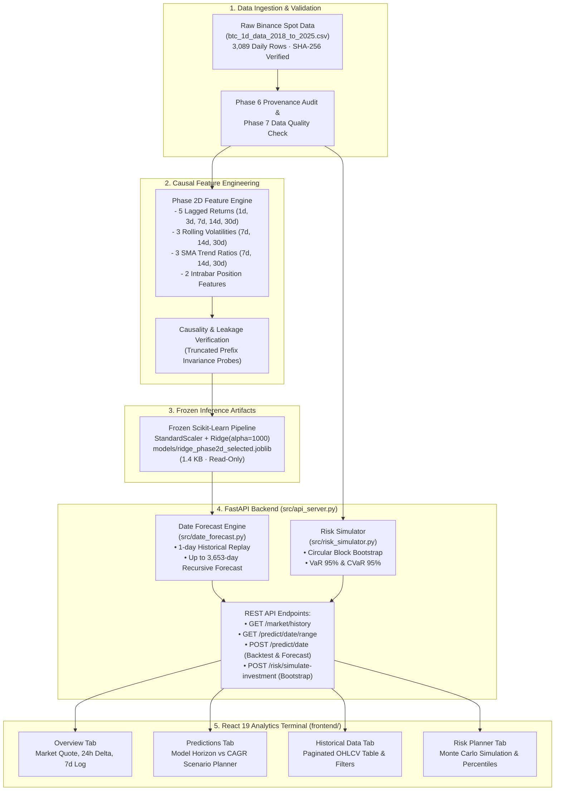

# Bitcoin Price Prediction Using Machine Learning

[](https://www.python.org/)
[](https://fastapi.tiangolo.com/)
[](https://react.dev/)
[](https://www.typescriptlang.org/)
[](https://vitejs.dev/)
[](https://tailwindcss.com/)
[](https://scikit-learn.org/)
[](https://docs.pytest.org/)
[](https://creativecommons.org/licenses/by-nc-sa/4.0/)

An end-to-end, full-stack quantitative research pipeline and analytics terminal for Bitcoin (**BTC/USDT**) daily price and return forecasting. 

This repository implements a production-grade machine learning system featuring strictly causal feature engineering, walk-forward cross-validation, frozen model inference, date-anchored historical backtesting, recursive multi-year forward price projection, and a Monte Carlo block-bootstrap risk simulator.

---

## Table of Contents

- [1. Project Overview](#1-project-overview)
- [2. Key Features](#2-key-features)
- [3. Demo and Screenshots](#3-demo-and-screenshots)
- [4. Technology Stack](#4-technology-stack)
- [5. Dataset Description](#5-dataset-description)
- [6. Machine Learning Methodology](#6-machine-learning-methodology)
- [7. Algorithm Selection: Why Ridge Regression?](#7-algorithm-selection-why-ridge-regression)
- [8. Evaluation Metrics and Results](#8-evaluation-metrics-and-results)
- [9. System Architecture](#9-system-architecture)
- [10. Directory Structure](#10-directory-structure)
- [11. Prerequisites](#11-prerequisites)
- [12. Installation Instructions (Windows)](#12-installation-instructions-windows)
- [13. How to Run Locally](#13-how-to-run-locally)
- [14. Model Usage and Programmatic Inference](#14-model-usage-and-programmatic-inference)
- [15. Configuration & Environment Variables](#15-configuration--environment-variables)
- [16. Git & GitHub Publishing Guide](#16-git--github-publishing-guide)
- [17. Vercel Deployment Architecture](#17-vercel-deployment-architecture)
- [18. Limitations](#18-limitations)
- [19. Future Improvements](#19-future-improvements)
- [20. Disclaimer](#20-disclaimer)
- [21. Author and Licensing](#21-author-and-licensing)

---

## 1. Project Overview

Predicting cryptocurrency market movements is notorious for non-stationarity, market regime shifts, and lookahead leakage. Many machine learning projects in this domain suffer from methodological flaws, such as training tree regressors directly on unadjusted raw prices (which fails completely when prices move outside historical boundaries) or shuffling time-series data into random cross-validation splits.

This project was built to establish a **rigorous, scientifically honest baseline** for next-day Bitcoin price prediction:

1. **Stationary Log-Return Formulation**: Instead of predicting unbounded price levels, models predict next-day close-to-close log returns, $\ln(\text{Close}_{t+1} / \text{Close}_t)$, which are reconstructed into price space only after inference.
2. **Strictly Causal Feature Pipeline**: All features are computed exclusively from market candles available at or before the forecast origin session. Zero lookahead leakage is enforced and programmatically verified via truncation probe tests.
3. **Chronological Splitting & Frozen Final Test**: The dataset is divided into three non-overlapping chronological segments (Train: 2018–2023, Validation: 2024, Final Test: 2025–mid 2026). The final test set was strictly held out and untouched until final evaluation.
4. **Full-Stack Analytics Terminal**: A lightweight FastAPI backend serves the frozen inference model alongside a modern React 19 + TypeScript terminal with interactive charting, scenario planning, historical OHLCV queries, and block-bootstrap risk simulations.
5. **Academic Honesty**: Phase 8 evaluation rigorously tested the best model against naive persistence and training-mean baselines using paired bootstrap hypothesis testing. The project explicitly reports that while Ridge Regression is the top-performing model, daily cryptocurrency returns exhibit low signal-to-noise ratio, and no statistically significant edge over a training-mean baseline is claimed.

---

## 2. Key Features

### 📈 Predictive Modeling & Backtesting
- **Frozen Read-Only Model**: Serves a regularized Ridge Regression pipeline (`StandardScaler` + `Ridge(alpha=1000.0)`) trained on 13 causal return, volatility, and trend features. No retraining or weight updating occurs at request time.
- **Date-Anchored Historical Backtest**: Replays one-session-ahead out-of-sample predictions for any historical date from 2018-04-02 to 2026-06-16, comparing predicted price against actual closing price.
- **Autoregressive Multi-Step Forward Projections**: Extends single-session daily models into forward multi-session projections up to **3,653 sessions (~10 years)** into the future by recursively feeding prior predictions back into subsequent feature calculations.

### 📊 Full-Stack Analytics Terminal
- **Overview Dashboard**: Displays current BTC/USDT spot quote, 24-hour and 7-day price percentage changes, 30-day average volume, 7-day recent sessions table, and one-click quick predictions.
- **Price Outlook & Scenario Planner**: Provides side-by-side comparison between the frozen machine learning model forecast (with preset 1Y, 2Y, 5Y, 10Y horizons) and an interactive compound annual growth rate (CAGR) scenario builder (-50% to +100%) paired with an investment return calculator ($100 to $10,000+).
- **Historical Market Data Explorer**: Fast, searchable, and paginated OHLCV data table with range presets (30D, 90D, 1Y, ALL) and aggregate metrics (period high, low, total volume, net price change).
- **Block-Bootstrap Risk Planner**: Non-parametric Monte Carlo simulation using circular block bootstrapping of historical returns. Computes 95% Value at Risk (VaR), 95% Expected Shortfall (CVaR), and empirical return distributions (p10, p25, p50, p75, p90) for custom holding periods (30 to 365 days).

### 🧪 Engineering & Verification
- **Automated Test Suite**: 14 test modules containing **154 passing pytest automated tests** covering endpoint schemas, feature causality, numerical precision, recursive forecast limits, and bootstrap convergence.
- **Production Performance**: Zero database dependency. Fast cold starts (<1.5 seconds) and low memory footprint (~10 MB bundle size before dependencies).

---

## 3. Demo and Screenshots

> *Placeholder: Add application screenshots and demo links after deploying to Vercel.*

| Dashboard View | Preview | Description |
|---|---|---|
| **Market Overview** | `` | Asset header, 24h/7d delta, 30d volume, and recent trading session log. |
| **Price Outlook & Scenarios** | `` | Multi-year model projection alongside user CAGR investment simulator. |
| **Historical Data Explorer** | `` | Paginated daily OHLCV series with date range filters and aggregate summaries. |
| **Risk Simulator (VaR/CVaR)** | `` | Block-bootstrapped investment outcome percentiles and loss distribution. |

- **Deployed Web Application**: `https://<your-vercel-frontend-domain>.vercel.app` *(add upon deployment)*
- **API Documentation (Swagger UI)**: `https://<your-vercel-backend-domain>.vercel.app/docs` *(or `http://127.0.0.1:8001/docs` locally)*

---

## 4. Technology Stack

### Backend & Machine Learning
- **Language**: Python 3.14 (pinned in `.python-version`)
- **API Framework**: FastAPI `0.135.1` (ASGI high-performance web framework)
- **ASGI Server**: Uvicorn `0.42.0`
- **Data & Modeling**:
  - `scikit-learn` `1.8.0` (Pipeline, StandardScaler, Ridge, Lasso, ElasticNet, LinearRegression, RandomForestRegressor)
  - `joblib` `1.5.3` (Model serialization & artifact caching)
  - `pandas` `3.0.1` & `numpy` `2.4.2` (Time series data transformation)
  - `scipy` `1.17.1` (Bootstrap resampling, binomial testing)
  - `pydantic` `2.12.5` (Request/response validation and schema enforcement)
  - `pyyaml` `6.0.3` (Experiment configuration parsing)
- **Testing**: `pytest` `9.0.3` (154 automated unit and integration tests)

### Frontend Terminal
- **Framework**: React `19.3.1` with React DOM
- **Language**: TypeScript `~7.0.2`
- **Build Tool**: Vite `8.3.4` with `@vitejs/plugin-react`
- **Styling**: Tailwind CSS `v4.3.3` with `@tailwindcss/vite`
- **Code Quality**: Oxlint `1.88.0` (ultra-fast JavaScript/TypeScript linter)

### Infrastructure & Deployment
- **Platform**: Vercel Serverless Functions (Python 3.14 runtime) & Vercel Static Hosting (Vite React bundle)
- **Configuration**: `vercel.json` (60s max execution duration, serverless exclude patterns)

---

## 5. Dataset Description

The project incorporates two datasets across its research lifecycle, with the primary production dataset independently verified against exchange archives:

### Primary Production Dataset (`btc_1d_data_2018_to_2025.csv`)
- **Source**: Binance Vision public data archives (Binance Spot, market `BTCUSDT`, interval `1d`). Verified in Phase 6 audit.
- **Location**: Root directory and `btc_prediction_experiment/data/raw/btc_1d_data_2018_to_2025.csv`.
- **Date Range**: `2018-01-01 00:00:00 UTC` through `2026-06-16 00:00:00 UTC`.
- **Dimensions**: **3,089 rows**, **12 columns**.
- **Cryptographic Checksum**: SHA-256 `c2d658852f4d82efd5fc6d98bdcabfd378bdb122404f3bfd39d00ef8fa30045b` (verified by test suite on each run).
- **Attributes**:
  1. `Open time` (ISO timestamp UTC)
  2. `Open` (Opening price in USDT)
  3. `High` (Highest traded price in session)
  4. `Low` (Lowest traded price in session)
  5. `Close` (Closing price in USDT)
  6. `Volume` (Base asset BTC volume)
  7. `Close time` (Session close timestamp UTC)
  8. `Quote asset volume` (Total USDT turnover)
  9. `Number of trades` (Count of executed trades)
  10. `Taker buy base asset volume` (Aggressive buy volume in BTC)
  11. `Taker buy quote asset volume` (Aggressive buy volume in USDT)
  12. `Ignore` (Binance legacy field)
- **Data License**: Creative Commons Attribution-NonCommercial-ShareAlike 4.0 International (CC BY-NC-SA 4.0).

### Secondary Exploratory Dataset (`coin_Bitcoin .csv` / `data`)
- **Source**: Kaggle cryptocurrency historical archives (CoinMarketCap daily snapshots).
- **Date Range**: `2013-04-29` to `2021-07-06` (2,991 rows, 10 columns).
- **Role in Project**: Used in early Phase 1–4 price-space benchmarks to demonstrate tree model failure on non-stationary price data before transitioning to log-return modeling.

---

## 6. Machine Learning Methodology

### 1. Target Variable Formulation
Standard price prediction projects often define target as raw price: $\text{Target} = \text{Close}_{t+1}$. Because Bitcoin price exhibits strong secular drift ($100 \to \$60,000+$), raw prices violate regression stationarity assumptions.

This project formulates the target as the **next-day close-to-close log return**:

$$\text{Target} = r_{t+1} = \ln\left(\frac{\text{Close}_{t+1}}{\text{Close}_t}\right)$$

Once the model predicts $\widehat{r}_{t+1}$, closing price is reconstructed mathematically:

$$\widehat{\text{Close}}_{t+1} = \text{Close}_t \times \exp(\widehat{r}_{t+1})$$

### 2. Strictly Chronological Split Protocol
Random train/test splits destroy temporal ordering and introduce severe data leakage in time series. We enforce strict chronological splits:

| Split Partition | Calendar Range | Scorable Rows | Usage Scope |
|---|---|---|---|
| **Development Train** | `2018-01-01` to `2023-12-31` | 2,100 | Feature engineering, scaler fitting, hyperparameter selection |
| **Held-Out Validation** | `2024-01-01` to `2024-12-31` | 366 | Out-of-sample model comparison and threshold validation |
| **Final Test (Reserved)** | `2025-01-01` to `2026-06-16` | 532 | Untouched final test protocol (evaluated only in Phase 8) |

*Note: The first 90 days of the training split serve as the feature calculation warm-up window.*

### 3. Causal Feature Engineering (Phase 2D)
A total of 46 candidate features were generated and subjected to walk-forward ablation. The selected frozen pipeline utilizes **13 strictly causal features** (the `drop_existing_volume` configuration):

| Feature Name | Category | Mathematical Description |
|---|---|---|
| `log_return_lag_1d` | Lagged Return | 1-day historical log return: $\ln(\text{Close}_t / \text{Close}_{t-1})$ |
| `log_return_lag_3d` | Lagged Return | 3-day cumulative log return: $\ln(\text{Close}_t / \text{Close}_{t-3})$ |
| `log_return_lag_7d` | Lagged Return | 7-day cumulative log return: $\ln(\text{Close}_t / \text{Close}_{t-7})$ |
| `log_return_lag_14d` | Lagged Return | 14-day cumulative log return: $\ln(\text{Close}_t / \text{Close}_{t-14})$ |
| `log_return_lag_30d` | Lagged Return | 30-day cumulative log return: $\ln(\text{Close}_t / \text{Close}_{t-30})$ |
| `return_volatility_7d` | Volatility | 7-day rolling population standard deviation of daily log returns |
| `return_volatility_14d` | Volatility | 14-day rolling population standard deviation of daily log returns |
| `return_volatility_30d` | Volatility | 30-day rolling population standard deviation of daily log returns |
| `close_sma_ratio_7d` | Trend / Moving Avg | Ratio of Close to 7-day Simple Moving Average minus 1 |
| `close_sma_ratio_14d` | Trend / Moving Avg | Ratio of Close to 14-day Simple Moving Average minus 1 |
| `close_sma_ratio_30d` | Trend / Moving Avg | Ratio of Close to 30-day Simple Moving Average minus 1 |
| `candle_range_relative` | Intrabar Structure | Intraday candle range relative to Close: $(\text{High}_t - \text{Low}_t) / \text{Close}_t$ |
| `close_position_in_range`| Intrabar Structure | Normalized position in range: $(\text{Close}_t - \text{Low}_t) / (\text{High}_t - \text{Low}_t)$ |

**Causality Assurance**: Feature values are validated using truncated prefix checks. Recomputing features using only data through date $t$ yields results bit-for-bit identical to calculating them on the full series.

---

## 7. Algorithm Selection: Why Ridge Regression?

Multiple algorithm families were developed and scored across the project's research phases. **Ridge Regression** was selected as the primary production model based on empirical evidence:

```
                            MODEL PERFORMANCE ON LOG RETURNS
                                 (Validation Split 2024)
  
  Model / Baseline                 Log-Return MAE    Price MAE (USD)   Directional Acc.
  -------------------------------------------------------------------------------------
  Ridge Regression (alpha=1000)        0.019976        $1,313.26           51.64%   <-- BEST
  Training-Mean Baseline               0.020028        $1,317.19           52.46%
  Zero-Return Persistence              0.020052        $1,318.15             N/A
  Random Forest (Tuned)                0.020081        $1,320.09           50.55%
  XGBoost (Tuned)                      0.020085        $1,321.30           51.09%
```

### Why Tree Models (Random Forest & XGBoost) Failed:
1. **Raw Price Inability to Extrapolate**: In early benchmark phases (`train_models.py`), Random Forest and XGBoost were trained on raw prices. During the 2020–2021 test period when Bitcoin surged beyond the training maximum, decision tree splits could not predict values higher than the historical training cap. Test $R^2$ collapsed to **-0.37** (Random Forest) and **-0.39** (XGBoost), with test MAE exceeding **$13,700**.
2. **Log-Return Overfitting**: When trained on stationary log returns in Phase 2C, decision trees still suffered from high variance. Even with shallow depths (`max_depth=2`, `min_samples_leaf=5`), both Random Forest ($MAE = 0.020081$) and XGBoost ($MAE = 0.020085$) performed worse than the simple naive persistence baseline ($0.020052$).

### Why Ridge Outperformed Other Linear Regressors:
- **Collinearity & Coefficient Blow-up**: Financial moving averages and multi-day returns exhibit strong multicollinearity. Ordinary Least Squares (OLS) creates erratic coefficient swings on collinear data.
- **Lasso & ElasticNet Over-Shrinkage**: In Phase 2B, Lasso and ElasticNet with optimal cross-validated regularizers shrank all coefficients to zero, degenerating into the training mean.
- **Ridge ($L_2$) Shrinkage**: Ridge regression with $\alpha = 1000.0$ applies smooth quadratic shrinkage, dampening coefficient variance without discarding signals. It produced the lowest validation log-return MAE ($0.019976$) and lowest price reconstruction MAE ($1,313.26 USD$).
- **Lightweight Inference**: The serialized model (`ridge_phase2d_selected.joblib`) is only **1.4 KB**, executes in under **0.5 milliseconds**, and requires no GPU or heavy C++ runtimes, making it ideal for serverless cold-start constraints.

---

## 8. Evaluation Metrics and Results

All evaluation figures presented below are verified directly from saved JSON artifacts in `outputs/metrics/` and `reports/`.

### Validation Split Results (Calendar Year 2024, 366 Days)

| Model / Baseline | Log-Return MAE | Log-Return RMSE | Price MAE (USD) | Price RMSE (USD) | Directional Accuracy |
|---|---|---|---|---|---|
| **Ridge Regression ($\alpha=1000$)** | **0.019976** | **0.027545** | **$1,313.26** | **$1,838.17** | **51.64%** (189/366) |
| **Training-Mean Baseline** | 0.020028 | 0.027577 | $1,317.19 | $1,839.94 | 52.46% (192/366) |
| **Zero-Return (Persistence)** | 0.020052 | 0.027621 | $1,318.15 | $1,842.19 | Abstains (0.0%) |
| **Random Forest (Tuned)** | 0.020081 | 0.027621 | $1,320.09 | $1,842.13 | 50.55% (185/366) |
| **XGBoost (Tuned)** | 0.020085 | 0.027602 | $1,321.30 | $1,844.34 | 51.09% (187/366) |

### Final Untouched Test Split Results (2025-01-01 to 2026-06-16, 532 Days)

Phase 8 executed the pre-registered evaluation protocol against the strictly held-out final test split:

```json
{
  "final_test_rows": 532,
  "final_test_range": "2025-01-01 to 2026-06-16",
  "training_mean_log_return_MAE": 0.020052,
  "zero_return_log_return_MAE": 0.020052,
  "training_mean_price_MAE": "$1,317.19 USD",
  "zero_return_price_MAE": "$1,318.15 USD",
  "directional_accuracy_corrected": 48.78%,
  "binomial_p_value_vs_coin_flip": 0.7282,
  "bootstrap_mae_diff_median": 0.000017,
  "bootstrap_mae_diff_95_ci": [-0.000027, 0.000063],
  "bootstrap_p_value": 0.7620
}
```

### Statistical Significance Verdict
1. **Log-Return MAE Criterion (FAIL)**: Paired bootstrap resampling (1,000 resamples) yielded a 95% confidence interval of `[-0.000027, 0.000063]`. Because the interval crosses zero ($p = 0.762 > 0.05$), the model demonstrates no statistically significant error reduction over the training mean.
2. **Directional Accuracy Criterion (FAIL)**: Corrected directional accuracy on the final test split was **48.78%** ($n = 531$). A one-sided binomial test against random coin-flip (50%) yielded $p = 0.7282$. The model does not demonstrate directional market timing capability.
3. **Price MAE Criterion (FAIL)**: Final test price MAE ($1,317.19) showed essentially zero improvement over the baseline, failing the pre-registered practical significance threshold of $100/BTC.
4. **Conclusion**: In accordance with scientific research standards, **no defensible predictive edge is claimed**. The results demonstrate that daily Bitcoin spot returns are consistent with weak-form market efficiency when modeled solely from historical OHLCV aggregates.

---

## 9. System Architecture



---

## 10. Directory Structure

```text
Bit coin price prediction/
├── .gitignore                          # Clean repository ignore rules
├── README.md                           # Comprehensive documentation (this file)
│
├── btc_prediction_experiment/          # Core production experiment & web application
│   ├── app.py                          # Vercel ASGI entrypoint (re-exports FastAPI app)
│   ├── vercel.json                     # Vercel serverless function configuration
│   ├── requirements.txt                # Pinned production Python dependencies
│   ├── .python-version                 # Pinned to Python 3.14
│   ├── .env.example                    # Backend environment template
│   ├── .gitignore                      # Experiment-level gitignore rules
│   │
│   ├── config/
│   │   └── experiment.yaml             # Chronological split dates & target definitions
│   │
│   ├── data/
│   │   └── raw/
│   │       └── btc_1d_data_2018_to_2025.csv  # 3,089 daily rows (Binance Vision)
│   │
│   ├── models/
│   │   ├── ridge_phase2d_selected.joblib     # Served frozen inference model (1.4 KB)
│   │   ├── random_forest_phase2b.joblib      # Research artifact (39.4 MB)
│   │   ├── xgboost_phase2b.joblib            # Research artifact (444 KB)
│   │   └── ...                               # Additional Phase 2B/2C comparison models
│   │
│   ├── outputs/
│   │   ├── features/                   # Verified causal feature CSV tables
│   │   ├── metrics/                    # JSON metrics for Phases 2A through 8
│   │   ├── predictions/                # Baseline and model prediction records
│   │   └── reports/                    # Final Phase 8 evaluation summaries
│   │
│   ├── docs/                           # Phase-by-phase technical documentation
│   │   ├── phase2b.md                  # Baseline evaluation report
│   │   ├── phase2d.md                  # Causal feature walk-forward ablation
│   │   ├── phase6_data_audit.md        # Binance Vision provenance audit
│   │   └── ...                         # Diagnostic and experiment notes
│   │
│   ├── src/                            # Backend source code modules (23 modules)
│   │   ├── api_server.py               # FastAPI application & REST endpoints
│   │   ├── date_forecast.py            # Backtesting & recursive forecasting engine
│   │   ├── risk_simulator.py           # Circular block-bootstrap Monte Carlo engine
│   │   ├── build_features.py           # Phase 2A causal feature calculations
│   │   ├── phase2d_features.py         # Phase 2D extended feature generation
│   │   ├── phase8_evaluation_protocol.py # Final untouched test evaluation protocol
│   │   └── ...                         # Data audit and training modules
│   │
│   ├── tests/                          # Automated Pytest suite (154 tests)
│   │   ├── test_api_date_forecast.py   # Prediction endpoint tests
│   │   ├── test_date_forecast.py       # Recursive projection & horizon limits
│   │   ├── test_risk_simulator.py      # Bootstrap statistical tests
│   │   ├── test_phase2d_features.py    # Causality and feature invariance tests
│   │   └── ...                         # Schema and data integrity tests
│   │
│   └── frontend/                       # React 19 + TypeScript Analytics Terminal
│       ├── package.json                # Frontend dependencies and scripts
│       ├── vite.config.ts              # Vite 8 configuration with API dev proxy
│       ├── tsconfig.json               # TypeScript strict configuration
│       ├── .env.example                # Frontend environment template
│       └── src/
│           ├── App.tsx                 # Root application component & navigation
│           ├── main.tsx                # React DOM entrypoint
│           ├── index.css               # Modern terminal stylesheet & Tailwind v4
│           ├── components/
│           │   └── ui.tsx              # Reusable terminal UI elements (Panel, Stat, Pill)
│           ├── lib/
│           │   ├── api.ts              # Type-safe API client wrappers
│           │   ├── format.ts           # USD, percentage, and integer formatters
│           │   └── market.ts           # OHLCV calculation and date utility helpers
│           └── pages/
│               ├── Overview.tsx        # Market overview & quick forecast
│               ├── Predictions.tsx     # Price outlook & CAGR scenario planner
│               ├── HistoricalData.tsx  # Paginated historical OHLCV data table
│               └── RiskPlanner.tsx     # Block-bootstrap risk & return simulation
│
├── btc_1d_data_2018_to_2025.csv        # Root copy of production Binance dataset
├── coin_Bitcoin .csv                   # Root exploratory Kaggle dataset (2013–2021)
├── preprocess.py                       # Exploratory v1 feature preprocessor
├── train_models.py                     # Exploratory v1 raw price model trainer
├── preprocess_v2.py                    # Exploratory v2 log-return preprocessor
├── train_v2.py                         # Exploratory v2 XGBoost trainer
├── evaluate_v2.py                      # Exploratory v2 model evaluator
├── lstm_v2.py                          # Exploratory v2 PyTorch LSTM neural network
├── evaluate_lstm_v2.py                 # Exploratory v2 LSTM evaluation
├── models/                             # Exploratory v1 saved joblib models
├── models_v2/                          # Exploratory v2 saved XGBoost and LSTM models
├── processed/                          # Exploratory v1 train/val/test CSV splits
├── processed_v2/                       # Exploratory v2 train/val/test CSV splits
└── reports/                            # Exploratory v1/v2 evaluation reports
```

---

## 11. Prerequisites

Before installing, ensure your environment has the following software installed:

| Software | Required Version | Purpose |
|---|---|---|
| **Python** | `3.11` to `3.14` (3.14 recommended) | Backend FastAPI service and ML inference |
| **Node.js** | `v20.x` or higher | Building and serving the React frontend |
| **npm** | `v10.x` or higher | JavaScript package management |
| **Git** | `v2.x` or higher | Source code management |
| **OS** | Windows 10/11 (or Linux/macOS) | Tested natively on Windows PowerShell |

---

## 12. Installation Instructions (Windows)

Follow these tested step-by-step commands in **Windows PowerShell**:

### Step 1: Clone the Repository
```powershell
git clone https://github.com/<your-username>/<your-repo-name>.git
cd "Bit coin price prediction"
```

### Step 2: Configure Python Virtual Environment & Install Backend
```powershell
# Navigate to the core experiment directory
cd btc_prediction_experiment

# Create a virtual environment
python -m venv .venv

# Activate the virtual environment
.venv\Scripts\Activate.ps1

# Upgrade pip and install pinned backend dependencies
python -m pip install --upgrade pip
pip install -r requirements.txt
```

### Step 3: Install Frontend Dependencies
```powershell
# Open a new terminal or navigate to the frontend directory
cd frontend

# Clean install pinned npm packages
npm ci
```

---

## 13. How to Run Locally

To run the complete application on your local machine:

### 1. Start the FastAPI Backend
From the `btc_prediction_experiment` directory (with `.venv` activated):
```powershell
uvicorn src.api_server:app --host 127.0.0.1 --port 8001 --reload
```
- The backend will start at: **`http://127.0.0.1:8001`**
- Interactive Swagger API docs: **`http://127.0.0.1:8001/docs`**
- Health status check: **`http://127.0.0.1:8001/health`**

### 2. Start the Vite React Frontend
In a separate terminal window, from `btc_prediction_experiment/frontend`:
```powershell
npm run dev
```
- The frontend terminal will start at: **`http://localhost:5173`**
- Vite dev server automatically proxies `/api/*` calls to the FastAPI backend at `http://127.0.0.1:8001`.

### 3. Run Automated Tests
To run the full suite of 154 automated backend tests:
```powershell
# From btc_prediction_experiment directory
python -m pytest tests -q
```

To run frontend TypeScript validation and linting:
```powershell
# From btc_prediction_experiment/frontend directory
npm run build
npm run lint
```

---

## 14. Model Usage and Programmatic Inference

The trained Ridge model can be loaded and executed programmatically in Python without running the web server:

```python
import math
import joblib
import numpy as np

# 1. Load the frozen model pipeline (StandardScaler + Ridge)
model_path = "btc_prediction_experiment/models/ridge_phase2d_selected.joblib"
model = joblib.load(model_path)

# 2. Provide the 13 strictly causal features computed at forecast origin:
# [log_return_lag_1d, 3d, 7d, 14d, 30d, 
#  return_volatility_7d, 14d, 30d, 
#  close_sma_ratio_7d, 14d, 30d, 
#  candle_range_relative, close_position_in_range]
features = np.array([
    0.0125, -0.0042, 0.0310, 0.0520, 0.0890,  # Lagged returns
    0.0185,  0.0210, 0.0245,                  # Rolling volatilities
    0.0150,  0.0280, 0.0450,                  # SMA ratios
    0.0210,  0.6500                           # Intrabar structure
]).reshape(1, -1)

# 3. Predict next-day log return
predicted_log_return = float(model.predict(features)[0])
print(f"Predicted next-day log return: {predicted_log_return:.6f}")

# 4. Reconstruct predicted closing price from latest observed close
current_close = 65420.50
predicted_close = current_close * math.exp(predicted_log_return)
print(f"Predicted next-day Close: ${predicted_close:,.2f} USD")
```

---

## 15. Configuration & Environment Variables

All configuration is managed cleanly through environment variables with sensible defaults for local development.

### Backend (`btc_prediction_experiment/.env.example`)
Create a `.env` file in `btc_prediction_experiment/` if running in production:

```env
# Comma-separated list of allowed frontend origins for CORS.
# For local development, localhost and 127.0.0.1 ports are allowed by default.
CORS_ALLOW_ORIGINS=http://localhost:5173,https://your-frontend-app.vercel.app
```

### Frontend (`btc_prediction_experiment/frontend/.env.example`)
Create a `.env.local` file in `btc_prediction_experiment/frontend/` if connecting to a remote backend:

```env
# Remote backend API base URL (omit trailing slash).
# If left empty in local dev, Vite automatically proxies /api to http://127.0.0.1:8001.
VITE_API_BASE_URL=https://your-backend-api.vercel.app
```

---

## 16. Git & GitHub Publishing Guide

### Verify Git Status
Before publishing, ensure your local repository is clean and that `.gitignore` correctly prevents committing virtual environments or node modules:

```powershell
# Check git status (from the repository root or btc_prediction_experiment)
git status
```

### Publishing the Project to GitHub
To publish this project to your GitHub account:

```powershell
# 1. Initialize git if not already initialized
git init

# 2. Add files to staging
git add .

# 3. Verify that node_modules, .venv, and caches are NOT staged
git status

# 4. Commit files
git commit -m "feat: Bitcoin price prediction ML research pipeline and React analytics terminal"

# 5. Create a new public repository on GitHub (via github.com)
# 6. Link remote origin and push
git remote add origin https://github.com/<your-username>/bitcoin-price-prediction.git
git branch -M main
git push -u origin main
```

---

## 17. Vercel Deployment Architecture

The application is structured for seamless deployment on Vercel using the **two-project architecture**:

```
                       ┌─────────────────────────────────────────┐
                       │             Vercel Account              │
                       └───────────────────┬─────────────────────┘
                                           │
                    ┌──────────────────────┴──────────────────────┐
                    ▼                                             ▼
       ┌─────────────────────────┐                   ┌─────────────────────────┐
       │   Project 1: Backend    │                   │   Project 2: Frontend   │
       │   FastAPI Serverless    │                   │   Vite + React Terminal │
       ├─────────────────────────┤                   ├─────────────────────────┤
       │ Root: btc_prediction_...│                   │ Root: .../frontend      │
       │ Framework: FastAPI      │                   │ Framework: Vite         │
       │ Entry: app.py           │                   │ Build: npm run build    │
       │ Output: vercel.json     │                   │ Output: dist            │
       │ Env: CORS_ALLOW_ORIGINS │                   │ Env: VITE_API_BASE_URL  │
       └─────────────────────────┘                   └─────────────────────────┘
```

### Why Two Projects?
Separating the backend Python serverless function from the static React build avoids serverless bundle limits, eliminates dev proxy dependencies in production, and provides independent scaling and logs for frontend and API.

### Deployment Steps

#### Backend Deployment:
1. In the Vercel Dashboard, click **Add New Project** and select your GitHub repository.
2. Set **Root Directory** to `btc_prediction_experiment`.
3. Select framework preset **FastAPI** (or Other). Vercel reads `app.py` and `vercel.json`.
4. Add Environment Variable:
   - `CORS_ALLOW_ORIGINS` = `https://<your-frontend-project-name>.vercel.app`
5. Click **Deploy**. Note down the assigned backend URL (e.g. `https://btc-api.vercel.app`).

#### Frontend Deployment:
1. In the Vercel Dashboard, click **Add New Project** for the same repository.
2. Set **Root Directory** to `btc_prediction_experiment/frontend`.
3. Select framework preset **Vite**.
4. Set Build Command to `npm run build` and Output Directory to `dist`.
5. Add Environment Variable:
   - `VITE_API_BASE_URL` = `https://btc-api.vercel.app` *(your deployed backend URL, without trailing slash)*.
6. Click **Deploy**.

### Serverless Platform Constraints
- **Bundle Limit**: Vercel serverless function size limit is 250 MB uncompressed (500 MB on Pro). The backend runtime dependencies and model artifacts take ~10 MB uncompressed. Heavy directories (`frontend/`, `tests/`, `docs/`) are explicitly excluded in `vercel.json`.
- **Ephemeral Filesystem**: The serverless environment is stateless and read-only. The API operates in 100% read-only mode using pre-computed model weights and data.
- **Execution Timeout**: Capped at 60 seconds (`maxDuration: 60` in `vercel.json`), well within typical sub-second API execution.

---

## 18. Limitations

1. **Market Efficiency & Low Signal-to-Noise Ratio**: Daily Bitcoin spot markets are highly liquid and efficient. While Ridge Regression achieved marginal out-of-sample improvements on 2024 validation data, Phase 8 evaluation confirms that daily returns do not offer a statistically significant predictive edge over a naive training-mean baseline.
2. **Recursive Forward Drift**: Single-day models rolled forward autoregressively across multi-year horizons (e.g. 5–10 years) compound small estimation errors. Intrabar features are held at their last observed session values. Multi-year projections represent mechanical continuations of model assumptions, not guaranteed price targets.
3. **Absence of Intraday Microstructure**: The model operates on daily aggregated candles ($1d$ interval) and does not incorporate high-frequency limit order book depth, liquidation cascades, or funding rate dynamics.
4. **No Transaction Cost or Slippage Modeling**: Backtested differences do not subtract exchange maker/taker fees, spread costs, or tax implications.

---

## 19. Future Improvements

- [ ] **High-Frequency & Orderflow Dynamics**: Expand dataset to 1-hour and 15-minute intervals incorporating Binance Futures open interest and liquidation volume.
- [ ] **Exogenous Macroeconomic Signals**: Ingest Federal Reserve interest rate decisions, US Dollar Index (DXY), Global Liquidity M2, and spot ETF net inflow metrics.
- [ ] **Conformal Prediction Intervals**: Implement non-parametric conformal prediction to output mathematically guaranteed coverage error bounds alongside point predictions.
- [ ] **Automated Retraining CI/CD Pipeline**: Schedule GitHub Actions cron jobs to periodically pull daily Binance Vision candles and compute walk-forward drift metrics.

---

## 20. Disclaimer

> **IMPORTANT NOTICE: RESEARCH PURPOSES ONLY**
>
> This software, documentation, and model predictions are provided strictly for **educational, academic, and research purposes**. 
> 
> Nothing contained in this repository, the API, or the web application constitutes financial, investment, legal, or trading advice. Cryptocurrency trading involves substantial risk of loss and is not suitable for every investor. The authors and contributors assume no liability for any financial decisions or losses incurred based on the outputs of this software.

---

## 21. Author and Licensing

- **Author**: Machine Learning Engineering Team / Repository Maintainer
- **Code License**: This project's code is available under the standard terms established by the repository owner (e.g., MIT License).
- **Dataset License**: The primary market dataset (`btc_1d_data_2018_to_2025.csv`) originates from Binance Vision public archives and is governed by the **Creative Commons Attribution-NonCommercial-ShareAlike 4.0 International License (CC BY-NC-SA 4.0)**. Redistribution must adhere to non-commercial terms and require proper attribution.
